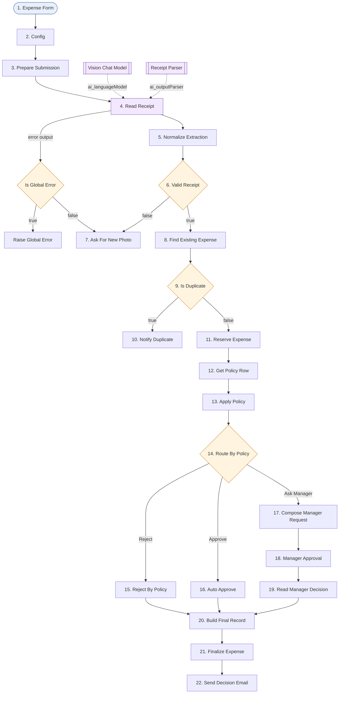

# Solution plan - 13-expense-receipt-assistant

- Статус: `tested` (план одобрен 2026-10-16; workflow-ите са създадени през n8n MCP 2026-10-17; основният поток - всички сценарии, чат агентът и седмичният отчет са потвърдени от Здравко 2026-10-17; Error Alert не е потвърден отделно)
- Версия: v1
- Workflow име: `Encorp | Homework | Week 03 | HW 06 | Expense Receipt Assistant` (`n8n-workflows/13-expense-receipt-assistant.json`)
- Бонус workflow-и (отделни файлове, същото име с друго описание, таг `encorp-homework`): `-weekly-report` (B1), `-chat-agent` + `-spending-lookup` (B2), `-error-alert` (B3)
- Таг: `encorp-homework`

## Изисквания
R1..R7 и B1..B3 са в `assignment.md`. Решения на Здравко: Form Trigger (Q1); имейл за нова снимка (Q4); дубликатът е без имейл в отпечатъка (Q5); дубликатът не трябва да минава и докато първата заявка чака мениджъра (Q6); BGN се превалутира автоматично (Q3); бонусите са отделни workflow-и (Q9). Давност на разписката и забравена `pending` заявка не се имплементират - само бележки за подобрение.

## Схема

## Нодове
| № | Нод | Защо | Ключови параметри | Покрива |
|---|-----|------|-------------------|---------|
| 1 | Expense Form (Form Trigger 2.3) | вход | име, имейл, отдел (dropdown), снимка (един файл); path `expense-receipt` | R1 |
| 2 | Config (Set 3.5) | настройки | `managerEmail`, `formUrl`, `bgnPerEur = 1.95583` | R3, R5, R6 |
| 3 | Prepare Submission (Set) | `submissionId`, нормализиран имейл, `submittedAt` | | R1 |
| 4 | Read Receipt (Basic LLM Chain 1.9) | чете снимката | Image (Binary) съобщение (първото binary поле); Retry On Fail 3x; error output | R2, B3 |
| 4a | Vision Chat Model (OpenRouter) | модел с vision | `google/gemini-2.5-flash` (да се провери/смени) | R2 |
| 4b | Receipt Parser (Structured Output Parser 1.3) | `isReceipt, merchant, date, total, currency, category, receiptNumber` | JSON пример | R2 |
| 5 | Normalize Extraction (Set) | чисти типове; `totalEur` (EUR, BGN през Config, иначе `eurKnown = false`); `fingerprint` = merchant\|date\|total\|currency | категория извън списъка -> Other | R2, R4, R5 |
| 6 | Valid Receipt (IF 2.3) | `isReceipt` и `total > 0` | | R3 |
| 7 | Ask For New Photo (Gmail) | причина + линк към формата | идва от IF false и от error output на нод 4 | R3, B3 |
| 8 | Find Existing Expense (Data Table Get) | търси `fingerprint` в `expenses` | Always Output Data | R4 |
| 9 | Is Duplicate (IF) | има ли `id` | | R4 |
| 10 | Notify Duplicate (Gmail) | имейл до служителя | | R4 |
| 11 | Reserve Expense (Data Table Insert) | ред `decision = pending` преди мениджъра | | R4, R7 |
| 12 | Get Policy Row (Data Table Get) | `expense_policy` по категория | Always Output Data | R5 |
| 13 | Apply Policy (Set) | `policyFound`, `policyAllowed`, `autoLimitEur` | | R5 |
| 14 | Route By Policy (Switch 3.2) | Reject: `allowed = false`; Approve: `totalEur <= auto_approve_up_to_eur`; fallback Ask Manager (над прага, друга валута, липсваща политика) | | R5 |
| 15 | Reject By Policy (Set) | `rejected`, `decidedBy = policy` | | R5 |
| 16 | Auto Approve (Set) | `approved`, `decidedBy = policy` | | R5 |
| 17 | Compose Manager Request (Code) | HTML със escape | | R6 |
| 18 | Manager Approval (Gmail 2.2, Send and Wait, Custom Form) | Decision, Approved amount, Comment | без Limit Wait Time | R6 |
| 19 | Read Manager Decision (Set) | нормализира; reject -> 0; празна сума -> заявената; над заявената -> заявената | | R6 |
| 20 | Build Final Record (Set) | единно място, откъдето четат двата края; `emailSubject`, `emailBody` (нод, добавен спрямо одобрения план без промяна в поведението) | | R7 |
| 21 | Finalize Expense (Data Table Update по `submissionId`) | крайно решение върху резервирания ред | | R7 |
| 22 | Send Decision Email (Gmail, текст) | решение, сума, коментар | | R7 |

Sticky Notes: Overview, Design Improvements, Setup, 4 групови. Бонус workflow-и:
- B1 `-weekly-report`: Monday Schedule + Manual Trigger -> Config Report -> Get Expenses -> Last Week Final Only (Filter) -> Summarize (department, category, decision, currency) -> Build Report Table (Code, вместо отделен Aggregate) -> Write Commentary (Basic LLM Chain) -> Build Report Email -> Send To Finance.
- B2 `-chat-agent`: Chat Trigger -> Expense Agent (+ Agent Chat Model, Simple Memory, Call n8n Workflow Tool). `-spending-lookup`: Execute Workflow Trigger -> Get Employee Expenses -> Category Match (Filter) -> Summarize Spending -> Format Result (Code).
- B3: Retry On Fail и error output в нод 4; `-error-alert`: Error Trigger -> Format Alert -> Telegram.

## Допускания и credentials
- Q7 (модел с vision), Q8 (един мениджър в Config), Q10, Q11 остават допускания, не са потвърдени.
- Credentials (само имена): OpenRouter, Gmail OAuth2, Telegram (B3). Data Tables: `expense_policy` (импорт на CSV), `expenses` (`test-data/expenses-header.csv`).
- `formUrl` и линковете за мениджъра зависят от `WEBHOOK_URL` на инстанцията.
- Settings -> Error Workflow на основния workflow се избира ръчно.

## Тестов план
`test-data/test-scenarios.md`.

## Покритие
R1 -> 1-3. R2 -> 4, 4a, 4b, 5. R3 -> 6, 7. R4 -> 8-10 (+11). R5 -> 12-16. R6 -> 17-19. R7 -> 11, 21, 22. B1/B2/B3 -> отделните workflow-и и нодове 4, 7.

## Непотвърдено (n8n 2.41.6)
- typeVersion, непотвърдени в репото: Switch 3.2, Summarize 1.1, Call n8n Workflow Tool 2.2, Chat Trigger 1.1, Simple Memory 1.3 - ако импортът даде проблем, експортирай единичен нод.
- Binary поле от Form Trigger (Read Receipt взима първото binary поле); дали Set нодовете (3.5, `binaryMode: separate`) пазят binary; параметри на Image (Binary) съобщението в chainLlm 1.9; number поле в Custom Form; типове на колоните след CSV импорт; какво връща Data Table Get без съвпадение (Always Output Data + IF); дали Update връща редове (затова Send Decision Email чете от Build Final Record).
- Задействане на error output на Read Receipt и текст на причината ("could not be read").

## Актуализация v2 (2026-10-17, след тестовете)
- Основен поток (35 нода): нови `Is Global Error` (IF, regex по текста на грешката: 401/402/403/429/5xx, credentials, quota, rate limit, network...) и `Raise Global Error` (Stop and Error). Error output на `Read Receipt` отива първо в `Is Global Error`: инфраструктурна грешка -> Stop and Error (задейства Error workflow-а `Expense Error Alert`), иначе -> `Ask For New Photo`. Причина: `onError: continueErrorOutput` иначе поглъща всички грешки и Error workflow-ът не се извиква.
- Error workflow се задейства само от продукционни (публикувани) изпълнения; ръчен тест не го извиква. Грешка в нодове след `Reserve Expense` (Gmail, Data Table) спира изпълнението и задейства Error workflow-а, но редът остава `pending` (бележка 10 в Sticky Note "Design improvements").
- Spending Lookup и Weekly Report: нов нод `Convert Amounts` (Set) преди `Summarize`, защото колоните на `expenses` са текст. Weekly Report: `Manual Trigger` -> `Manual Test Window` (последните 7 дни) за ръчен тест; седмичният график запазва предишната календарна седмица.
- Node groups в n8n: Intake, Duplicate check, Policy routing, Manager approval, Final record and result (основен); Lookup and summarize (Spending Lookup); Collect and summarize, Commentary and e-mail (Weekly Report); Alert (Error Alert). Chat Agent няма групи.
- Режим на доставка: директно в n8n през MCP; JSON файловете в `n8n-workflows/` са експорт на живите workflow-и, санитизиран (Telegram chat id, имейли, домейн във `formUrl` са плейсхолдъри; `errorWorkflow` е махнат от settings).

## Скрийншоти (доказателство за тестовете)
Папка `screenshots/`. Входните данни са в `test-data/test-scenarios.md`; пощенските кутии са публични mailsac тестови адреси.

| Файл | Какво показва | Сценарий |
|---|---|---|
| `execution-01-weekly-report-email.png` | седмичен отчет (ръчен тест, последните 7 дни) с таблица и коментар | бонус B1 |
| `execution-02-ask-new-photo-email.png` | "the image does not look like a receipt" - молба за нова снимка | не е бележка (R3) |
| `execution-03-policy-reject-email.png` | отказ от политиката (Entertainment не се възстановява) | reject (R5) |
| `execution-04-manager-reject-email.png` | отказ от мениджъра (Travel 475.50 EUR) | мениджър - отказ (R6) |
| `execution-05-manager-approve-partial-email.png` | одобрение от мениджъра с по-малка сума (200 от 386 EUR) и коментар | мениджър - одобрение (R6) |
| `execution-06-inbox-duplicate-and-approved.png` | в една кутия: дубликат и последвало решение за хотел | R4 + R6 |
| `execution-07-manager-approval-form.png` | формата за решение на мениджъра (Send and Wait, Custom Form) | R6 |
| `execution-08-manager-request-email.png` | имейлът до мениджъра с данните и причината за запитването | R6 |
| `execution-09-duplicate-email.png` | "Your receipt was already submitted" | дубликат (R4) |
| `execution-10-telegram-error-alert.png` | Telegram аларма при счупени OpenRouter credentials (Raise Global Error) | бонус B3 |
