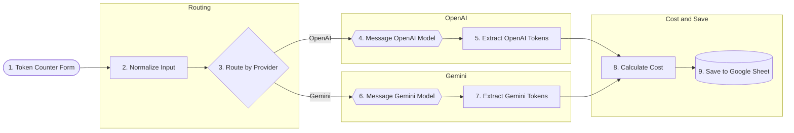

# 14-token-counter - Solution plan

- Статус: `tested` (Здравко потвърди пълен успешен тест на 2026-10-22; създаден през MCP, id `ZKIAUoQPdr5bCpv6`)
- Версия: v1
- Workflow: `Encorp | Homework | Week 04 | HW 01 | Token Counter` (id `ZKIAUoQPdr5bCpv6`), таг `encorp-homework`

## Схема

## Нодове

| № | Група | Нод | Версия | Покрива |
|---|-------|-----|--------|---------|
| 1 | - | Form Trigger (`formTrigger`) | 2.6 | R1 |
| 2 | Routing | Set (`set`) - prompt, model, provider, submittedAt | 3.5 | R2 |
| 3 | Routing | Switch (`switch`) по provider | 3.4 | R2 |
| 4 | OpenAI | `@n8n/n8n-nodes-langchain.openAi` text/response, `simplify: false`, `maxTokens: 2048` | 2.3 | R3, R4 |
| 5 | OpenAI | Set - `usage.input_tokens / output_tokens / total_tokens` | 3.5 | R5 |
| 6 | Gemini | `@n8n/n8n-nodes-langchain.googleGemini` text/message, `simplify: false`, `maxOutputTokens: 2048` | 1.2 | R3, R4 |
| 7 | Gemini | Set - `usageMetadata`; completion = candidates + thoughts | 3.5 | R5 |
| 8 | Cost and Save | Code - таблица с цени (USD / 1M), cost = tokens / 1e6 x цена | 2 | R6 |
| 9 | Cost and Save | Google Sheets append, `cellFormat: RAW` | 4.7 | R7, R8 |

## Допускания (виж assignment.md, Q1-Q6 - всички потвърдени)
- Модели: `gpt-6-luna` (0.10 / 0.50), `gpt-6.1-sol` (2.00 / 10.00), `gemini-3.1-flash-lite` (0.25 / 1.50), `gemini-3.6-flash` (0.75 / 3.75, промо цена до 2026-12-31) - USD на 1M токена, по официалните страници на 2026-10-22.
- Gemini thinking токените се броят като completion.
- Цените са в един Code нод.

## Credentials
`OpenAI account` (openAiApi), `Google Sheets account ai-academy` (googleSheetsOAuth2Api), Gemini (googlePalmApi) - създава се ръчно.

## Тестов план
1. Един prompt към 4-те модела -> 4 реда; `total = input + completion`; ръчна проверка на цената на един ред.
2. Кратък prompt (`Hi`) към `gemini-2.5-flash` - thinking токените са в completion.
3. Модел извън ценовата таблица -> ред с празна цена.

## Отворено
- Google Sheet "Token Counter" е създаден със заглавен ред (таб `Лист1`) и е свързан в нода; Gemini credential е свързан.
- Имената на полетата `usage` / `usageMetadata` са потвърдени при тест.
