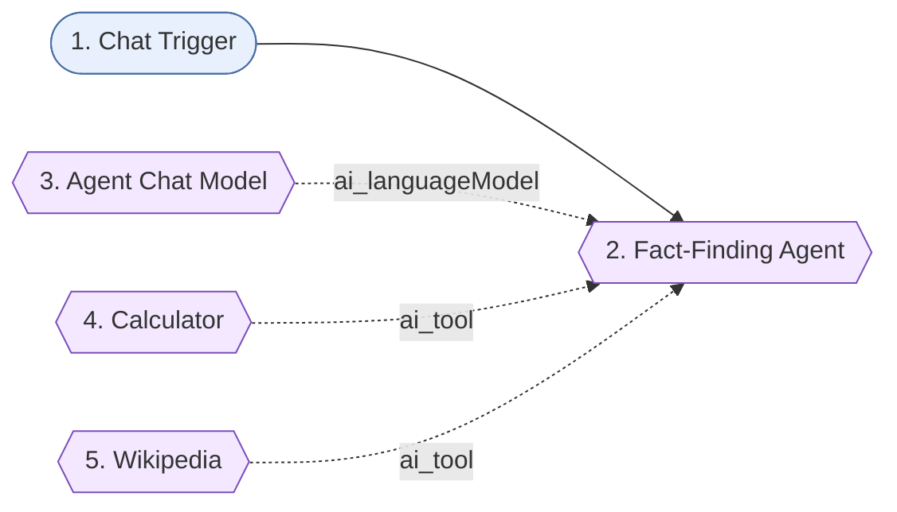

# 15-fact-finding-agent - Solution plan

- Статус: `tested` (Здравко потвърди T1-T5 на 2026-10-22; създаден през MCP, id `RIuJ4dtYVrCtAjA4`, непубликуван)
- Версия: v2 (промпт: краен отговор само "short and in the language of the question"; v1 е в `n8n-workflows/_versions/15-fact-finding-agent/v1.json`)
- Workflow: `Encorp | Homework | Week 04 | HW 02 | Fact Finding Agent`, таг `encorp-homework`
- Тестове: `test-data/test-scenarios.md`

## Изисквания

R1 workflow с AI агент; R2 tools Calculator + Wikipedia; R3 многостъпкови въпроси; R4 тест с Queen Victoria (63 x 3 = 189); R5 правилен избор на tool и точен краен отговор. Подробно: `assignment.md`.

## Схема

## Нодове

| № | Група | Нод | Защо е тук | Ключови параметри | Покрива |
|---|-------|-----|-----------|-------------------|---------|
| 1 | - | Chat Trigger (`chatTrigger` 1.5) | Свободен въпрос от чата на n8n | по подразбиране | R4 |
| 2 | - | Fact-Finding Agent (`agent` 3.1) | Tool calling агент, сам избира инструмента | `promptType: define`, `text = {{ $json.chatInput }}`, системен промпт, `maxIterations 10` | R1, R3, R5 |
| 3 | - | Agent Chat Model (`lmChatOpenRouter` 1) | Модел на агента | `openai/gpt-4o-mini`, temperature 0, maxRetries 3, credential "OpenRouter Encorp Academy Homeworks" | R1 |
| 4 | - | Calculator (`toolCalculator` 1) | Точна аритметика | - | R2, R5 |
| 5 | - | Wikipedia (`toolWikipedia` 1) | Търсене на факти | - | R2, R5 |

Групи Sticky Notes няма (5 нода, един етап). Има един общ Sticky Note `Overview` с потока и покритието.

## Системен промпт (същност)

Фактите само от Wikipedia, никога по памет; цялата аритметика само през Calculator; първо търсене, после изчисление; при изрична продължителност ("63 years and 216 days") се ползват цели години, иначе се смята от датите; при липса на информация агентът го казва, без да измисля числа; крайният отговор е кратък и на езика на въпроса (v1 изискваше още формат: факт, изчисление, резултат с получер шрифт; махнато от Здравко във v2).

Наблюдение (T1): агентът вика Wikipedia два пъти (списък на монарсите, после статията за Виктория) - безвредно, верен резултат.

## Допускания (от assignment.md)

Q2 Chat Trigger; Q3 OpenRouter gpt-4o-mini; Q4 готов Wikipedia tool нод; Q5 цели години (63 -> 189); Q6 без памет. Приети с одобрението на плана (2026-10-22).

## Credentials

OpenRouter (`OpenRouter Encorp Academy Homeworks`, вече свързан). Wikipedia и Calculator не искат.

## Покритие

R1 -> 2; R2 -> 4, 5; R3, R5 -> 2 (промпт + tools); R4 -> тест T1.

## Режим на доставка

Директно в n8n през MCP (личен проект, непубликуван) + санитизиран JSON в `n8n-workflows/15-fact-finding-agent.json` (v2, експорт от n8n след ръчната промяна на промпта).
