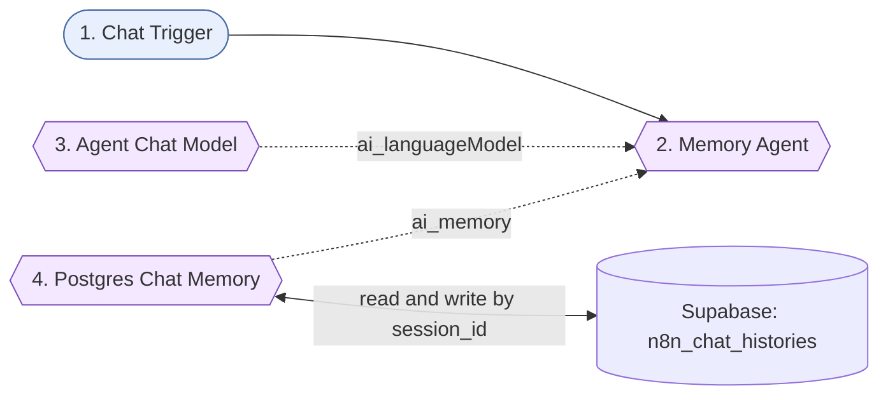

# 16-long-term-memory-agent - Solution plan

- Статус: `tested` (Здравко потвърди T1, T2, T3, T5 на 2026-10-22; T4 не е проверен - в тестовия чат на n8n няма как да се държат две сесии; създаден през MCP, id `FVRIPPuU7skXYO1Y`, непубликуван)
- Версия: v1
- Workflow: `Encorp | Homework | Week 04 | HW 03 | Long Term Memory Agent`, таг `encorp-homework`
- Тестове: `test-data/test-scenarios.md`

## Изисквания

R1 безплатна Supabase Postgres; R2 таблица id, session_id, message jsonb; R3 агентът записва историята след всяко взаимодействие; R4 преди отговор чете историята за текущия session_id; R5 тест "My favorite color is blue." -> "What is my favorite color?". Подробно: `assignment.md`.

## Схема



## Нодове

| № | Група | Нод | Защо е тук | Ключови параметри | Покрива |
|---|-------|-----|-----------|-------------------|---------|
| 1 | - | Chat Trigger (`chatTrigger` 1.5) | Чат за теста; дава `sessionId` на разговора | по подразбиране | R5 |
| 2 | - | Memory Agent (`agent` 3.1) | Tools Agent с памет | `promptType: define`, `text = {{ $json.chatInput }}`, системен промпт, `maxIterations 10` | R3, R4 |
| 3 | - | Agent Chat Model (`lmChatOpenRouter` 1) | Модел | `openai/gpt-4o-mini`, temperature 0, maxRetries 3, "OpenRouter Encorp Academy Homeworks" | R3 |
| 4 | - | Postgres Chat Memory (`memoryPostgresChat` 1.4) | Чете историята преди отговор и записва след него | `sessionIdType: fromInput`, `tableName: n8n_chat_histories`, `contextWindowLength: 20`, "Postgres Weekly Shopping Assistant" | R2, R3, R4 |

Групи Sticky Notes няма (4 нода, един етап). Има един общ Sticky Note `Overview`.

## Таблица (Supabase, проект `weekly-shopping-assistant`)

```sql
create table public.n8n_chat_histories (
  id serial primary key,
  session_id varchar(255) not null,
  message jsonb not null
);
create index n8n_chat_histories_session_id_idx on public.n8n_chat_histories (session_id);
alter table public.n8n_chat_histories enable row level security;
```

Миграция `create_n8n_chat_histories`. RLS е включен без политики (таблицата не е достъпна през публичния Data API; n8n влиза през Postgres връзка). Таблицата е временна. Здравко потвърди изтриването (2026-10-22), но `drop table` през Supabase MCP беше отменен (деструктивна операция). Изтриване на ръка в Supabase SQL Editor: `drop table if exists public.n8n_chat_histories;`. Статус на таблицата: още съществува, чака ръчно изтриване.

## Допускания (от assignment.md)

Q2 съществуващият проект (отговор на Здравко); Q3 Postgres Chat Memory нод (отговор на Здравко); Q4 Chat Trigger; Q5 OpenRouter gpt-4o-mini; Q6 прозорец 20; Q7 име `n8n_chat_histories`; Q8 готовият Postgres credential (потвърдено от смоук теста, че сочи към тази база). Q4-Q8 приети с одобрението на плана (2026-10-22).

## Credentials

`OpenRouter Encorp Academy Homeworks`, `Postgres Weekly Shopping Assistant` (и двата вече са свързани).

## Покритие

R1 -> Supabase проектът; R2 -> таблицата; R3 -> нодове 2 + 4 (запис); R4 -> нод 4 (четене); R5 -> тест T1/T2.

## Смоук тест (MCP, 2026-10-22)

Изпълнение 2242 (manual): `loadMemoryVariables` с празна история, отговорът "Got it! Your favorite color is blue.", `saveContext`; в таблицата 2 реда (human, ai). Двустъпковото припомняне (T1) трябва да се пусне в Chat панела, защото MCP стартира нова сесия при всяко извикване.

## Режим на доставка

Директно в n8n през MCP (личен проект, непубликуван) + санитизиран JSON `n8n-workflows/16-long-term-memory-agent.json`.
