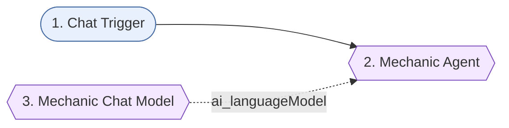

# 17-system-prompt-fun - Solution plan

- Статус: `tested` (Здравко потвърди тестовите сценарии T1-T8 на 2026-10-22; създаден през MCP, id `vzMPsOjXK7iuqBew`, непубликуван)
- Версия: v1
- Workflow: `Encorp | Homework | Week 04 | HW 04 | System Prompt Fun`, таг `encorp-homework`
- Промпт: `system-prompt.md`; тестове: `test-plan.md`

## Изисквания

R1 детайлен system prompt с персона; R2-R5 секции Role and Objective, Instructions & Constraints, Reasoning/Thinking Steps, Output Format; R6 имплементация в n8n AI агент; R7 тест с няколко заявки за последователност. Подробно: `assignment.md`.

## Схема

## Нодове

| № | Група | Нод | Защо е тук | Ключови параметри | Покрива |
|---|-------|-----|-----------|-------------------|---------|
| 1 | - | Chat Trigger (`chatTrigger` 1.5) | Свободен текст, тест в чата на n8n | по подразбиране | R6, R7 |
| 2 | - | Mechanic Agent (`agent` 3.1) | Носи system prompt-а (агент, както иска условието) | `promptType: define`, `text = {{ $json.chatInput }}`, `systemMessage` = промптът, `maxIterations 5`, без tools | R1-R6 |
| 3 | - | Mechanic Chat Model (`lmChatOpenRouter` 1) | Моделът на агента | `openai/gpt-4o-mini`, temperature 0.7, maxRetries 3, credential "OpenRouter Encorp Academy Homeworks" | R6 |

Групи Sticky Notes няма (3 нода, един етап). Има един общ Sticky Note `Overview` с потока и покритието.

## Допускания (от assignment.md)

Q2 персона: шеговит автомонтьор (отговор на Здравко); Q3 език: български (отговор на Здравко); Q4 четирите секции дословно от условието; Q5 Chat Trigger; Q6 gpt-4o-mini при temperature 0.7; Q7 тематика: технологии чрез автосервизни аналогии; Q8 без памет и tools; Q9 оценка по чеклист C1-C6. Q4-Q9 са приети с одобрението на плана (2026-10-22).

## Credentials

OpenRouter (`OpenRouter Encorp Academy Homeworks`, свързан).

## Покритие

R1-R5 -> System Message на нод 2; R6 -> нодове 1-3; R7 -> сценарии T1-T8 в `test-plan.md`.

## Режим на доставка

Директно в n8n през MCP (личен проект, непубликуван) + санитизиран JSON в `n8n-workflows/17-system-prompt-fun.json`.
