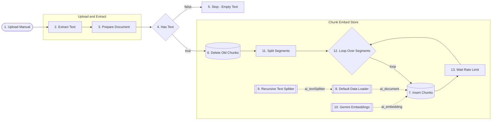
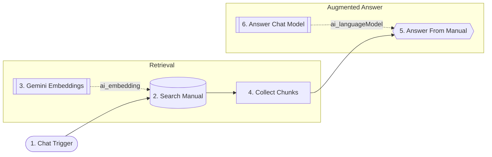

# 18-personal-rag - Solution plan

- Статус: `json-delivered` (2026-10-23; създадено през MCP, непубликувано; тестван от Здравко с резервации: T3 и T6 частични, T7 и T8 пропуснати - виж `test-plan.md` и "Опции за подобрение")
- Версия: v3 (v1: PDF през Extract From File, празен текст, D-022; v2: txt; v3: цикъл по сегменти и пауза заради лимитите на Gemini, D-023)
- Workflow 1: `Encorp | Homework | Week 04 | HW 05 | Personal RAG Ingest`, таг `encorp-homework`, id `I8vF7IT8l61GJjUA`
- Workflow 2: `Encorp | Homework | Week 04 | HW 05 | Personal RAG Ask`, таг `encorp-homework`, id `LsO3QY8fZB9SqadC`
- Тестове: `test-plan.md`

## Изисквания

R1 документ; R2 `vector` разширение; R3 таблица с правилна размерност; R4 Workflow 1 (чете, реже, embeddings, качва); R5 въпрос; R6 embedding на въпроса; R7 търсене в Supabase vector store; R8 въпрос + chunks към LLM, отговор само от текста. Подробно: `assignment.md`.

## Схема

Workflow 1, Ingest (v3):

Workflow 2, Ask:

## Нодове

Workflow 1 (Ingest, v2)

| № | Група | Нод | Защо е тук | Ключови параметри | Покрива |
|---|---|---|---|---|---|
| 1 | - | Form Trigger 2.6 | Качване на текстов файл при всяко пускане | едно file поле, `.txt,.md`, един файл | R1 |
| 2 | Upload and Extract | Extract From File 1.1 | Файл -> текст | `text`, destinationKey `text` | R4 |
| 3 | Upload and Extract | Edit Fields 3.5 | text и source (име на файла) | | R4 |
| 4 | - | IF 2.3 (Has Text) | Спира, ако няма текст | text не е празен | надеждност |
| 5 | - | Stop and Error 1 | Ясна грешка вместо мълчаливо success | | надеждност |
| 6 | Chunk Embed Store | Postgres 2.7, Execute Query (бонус) | Трие старите chunks на същия файл | delete where metadata->>'source' = $1, Always Output Data | бонус |
| 7 | Chunk Embed Store | Supabase Vector Store 1.3, insert | Качва chunks с embeddings | manual_chunks, match_manual_chunks, batch 50 | R4 |
| 8 | Chunk Embed Store | Default Data Loader 1.1 | Подава текста, добавя metadata source | JSON, custom text splitting | R4 |
| 9 | Chunk Embed Store | Recursive Character Text Splitter | Реже на chunks | 1000 символа, припокриване 200 | R4 |
| 10 | Chunk Embed Store | Embeddings Google Gemini | Вектор за всеки chunk | credential Google Gemini(PaLM) - Encorp AI Academy | R4 |

Workflow 2 (Ask)

| № | Група | Нод | Защо е тук | Ключови параметри | Покрива |
|---|---|---|---|---|---|
| 1 | - | Chat Trigger 1.5 | Приема въпроса | по подразбиране | R5 |
| 2 | Retrieval | Supabase Vector Store 1.3, load | Търси най-близките chunks; embedding на въпроса е вътре чрез под-нода | prompt = chatInput, topK 5 | R6, R7 |
| 3 | Retrieval | Embeddings Google Gemini | Същият модел като при индексирането | | R6 |
| 4 | Retrieval | Aggregate | Слива откъсите в списък | document.pageContent | R7 |
| 5 | Augmented Answer | Basic LLM Chain 1.9 | Въпрос + откъси към модела | системен промпт: само от откъсите | R8 |
| 6 | Augmented Answer | OpenRouter Chat Model | Модел | openai/gpt-4o-mini, temperature 0 | R8 |

## Supabase (проект weekly-shopping-assistant)

- Разширение `vector`.
- Таблица `public.manual_chunks` (`id bigserial`, `content text`, `metadata jsonb`, `embedding vector(3072)`), RLS включен.
- Функция `public.match_manual_chunks(query_embedding vector(3072), match_count int, filter jsonb)` с косинусово разстояние.
- Без индекс върху embedding (виж D-021).

## Допускания (от assignment.md)

Q1 отговорено (собствен PDF с Toyota Avensis, Form Trigger, Extract From File); Q2-Q9 приети с одобрението на плана (2026-10-23). v2: PDF-ът се конвертира в текст преди качване (решение на Здравко, 2026-10-23).

## Решения (виж D-021 в DECISIONS.md)

1. Без индекс върху embedding колоната: 3072 надвишава лимита от 2000 измерения на HNSW/IVFFlat за типа vector; за един документ точното търсене стига. Алтернатива при растеж: halfvec(3072) с HNSW.
2. Embedding на въпроса остава в Embeddings под-нода на vector store нода (R6), а не като отделна стъпка; гарантира същия модел при индексиране и търсене.
3. Basic LLM Chain, а не Agent с retrieve-as-tool: търсенето става винаги, стъпките са видими.
4. Бонус Delete Old Chunks срещу дубликати при повторно качване.
5. Нова таблица в съществуващия проект (безплатният план ограничава активните проекти).
6. Form Trigger за качване и Extract From File за PDF, по избор на Здравко.

## Credentials

Google Gemini(PaLM) - Encorp AI Academy; Supabase - Weekly Shopping Assistant; Postgres Weekly Shopping Assistant; OpenRouter Encorp Academy Homeworks.

## Покритие

R1 -> Ingest нод 1; R2 -> миграция; R3 -> таблица vector(3072); R4 -> Ingest 1-8; R5 -> Ask 1; R6 -> Ask 2-3; R7 -> Ask 2, 4; R8 -> Ask 5-6.

## Режим на доставка

Директно в n8n през MCP (личен проект, непубликувани) + санитизирани JSON `n8n-workflows/18-personal-rag-ingest.json` и `18-personal-rag-ask.json`.

## Изградено (MCP, 2026-10-23)

- Миграция `create_manual_chunks_vector_store` в проекта `weekly-shopping-assistant`: `vector` 0.8.2 (схема `extensions`), `public.manual_chunks` с `embedding vector(3072)`, RLS включен, функция `public.match_manual_chunks`. Проверено: тип на колоната `vector(3072)`, `relrowsecurity = true`, функцията съществува.
- Двата workflow-а са създадени с тага `encorp-homework`, всички credentials са свързани по id; 8 нода + 3 Sticky Notes (Ingest) и 6 нода + 3 Sticky Notes (Ask), по 2 node groups във всеки. Диаграмите съвпадат с JSON-а (8 нода/7 връзки и 6 нода/5 връзки).
- Отклонения от плана: няма. Допълнение: във формата има второ поле `Max pages` (0 = всички), с което се прави смоук тест с няколко страници без редакция на workflow-а.
- Embedding моделът е `models/gemini-embedding-001` (по подразбиране на нода, 3072 измерения). `gemini-embedding-2` от примера в условието не е проверен.

## v2 (2026-10-23)

- Причина: изпълнение 2762 на Ingest (v1, PDF, Max pages 0) върна `numpages 652`, но `text` празен; нищо не е записано. PDF-ът има текстов слой (маркира се и копира), `pdftotext` го извлича чисто (около 720 000 символа, около 900 chunks).
- Промяна: формата приема `.txt,.md`; Extract From File е в режим `text`; полето `Max pages` е махнато; добавени са `Has Text` и `Stop - Empty Text`. Конвертирането PDF -> текст е еднократна стъпка преди качване: `test-data/pdf_to_text.py` (маркери `[Страница N]` за цитиране). За смоук тест: `--pages 30`.
- Файловете за теста (не са в репото): `attachments/PZ49X-20C20-BG.txt` и `PZ49X-20C20-BG_first30pages.txt`.
- Не е доказано защо парсерът на n8n връща празен текст (възпроизвеждане не беше възможно); препоръката е да не се разчита на PDF режима за този файл.

## v3 (2026-10-23)

- Причина: Ingest v2 с целия `.txt` записа точно 100 реда и падна с `vector must have at least 1 dimension` (изпълнения 2787 и 2790, партиди 50 и 10). Лимитите на Gemini Embedding 1 в акаунта (AI Studio): 100 заявки/мин, 30K токена/мин, 1 000 заявки/ден. Над 100 вграждания в минута Gemini връща празен вектор вместо 429 (хипотеза, съвпада с двата опита; не е проверена директно).
- Промяна: след `Delete Old Chunks` - `Split Segments` (Code, JavaScript; сегменти по ~60 000 знака, рязане преди маркер `[Страница`), `Loop Over Segments` (batch 1), `Insert Chunks`, `Wait Rate Limit` (65 s) обратно към цикъла. Recursive Text Splitter е 2000/200 (около 470 chunks вместо около 1 050, за да се събере в дневния лимит). Default Data Loader чете `$json.text` на текущия сегмент; metadata `source` и `segment`. `embeddingBatchSize` 10.
- Очаквано: 13 сегмента (60 000 знака), около 470 заявки, около 14 минути. Реално: 469 реда, 13 сегмента.
- PDF клон със Switch и Merge не е направен: Python Code нодът в n8n 2.x няма достъп до binary, импортите са блокирани по подразбиране и стандартната библиотека няма PDF парсер (проверено с документацията, 2026-10-23). PDF се конвертира предварително (D-022).

## Опции за подобрение (не са приложени)

Контекст: в тестовете T3 (въпрос с дума "стандартно" вместо "препоръчително") и T6 (въпрос на английски към български документ) Ask върна "не намирам информация", макар откъсът да е в таблицата. Причината е в извличането (кои откъси влизат в топ 5), не в LLM-а; кои откъси са върнати не е проверено.

| # | Опция | Какво променя | Плюсове | Минуси |
|---|-------|---------------|---------|--------|
| 1 | `topK` 5 -> 8 в Search Manual | повече кандидат-откъси към LLM | една промяна на параметър, без нови нодове | повече токени и шум; не решава сигурно езиковата разлика |
| 2 | Преписване на въпроса преди търсенето: LLM нод превежда въпроса на езика на документа (български) и добавя 2-3 синонима | нов нод между Ask Question и Search Manual | решава T6 и вероятно T3 | още един LLM вик, още латентност и цена; променя дизайна (R6 остава, embedding пак е в под-нода) |
| 3 | Няколко търсения (multi-query) и обединяване на откъсите | няколко Search нода или цикъл + Merge/Aggregate | по-голямо покритие | сложност, повече Gemini заявки (лимит 100/мин) |
| 4 | Хибридно търсене: pgvector + ключови думи (`tsvector`) | нова колона и функция в Supabase, различен RPC | хваща точни термини | извън обхвата на домашното, нужна миграция |
| 5 | По-малки chunks (1000/200) | пълно ново индексиране | по-прецизни откъси | над 1 000 заявки на Gemini за един пълен Ingest, не се събира в дневния лимит |

Препоръка при следващата итерация: 1 + 2 (параметърът и преводът на въпроса). Системният промпт на Ask вече казва да се отговаря на езика на въпроса, затова преводът е нужен само за търсенето, а отговорът остава на езика на потребителя.

