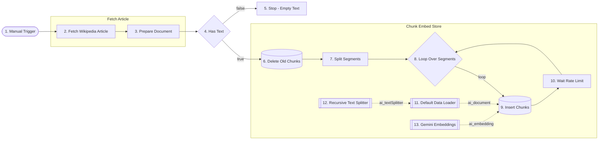
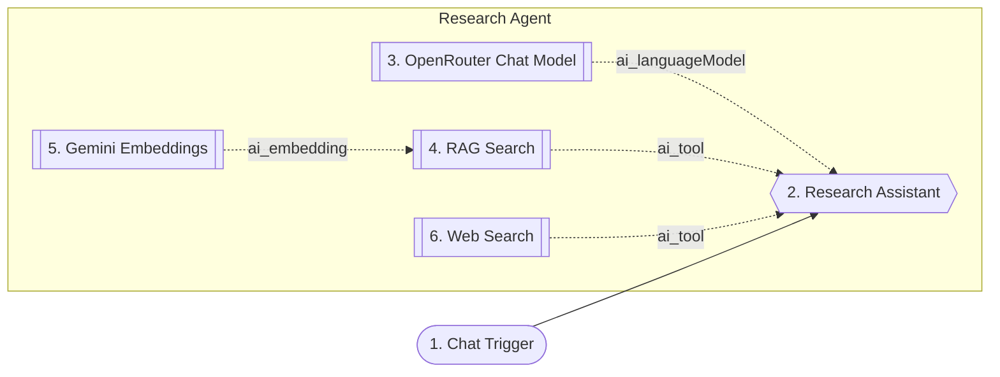

# 20-rag-research-assistant - Solution plan

- Статус: `json-delivered` (2026-10-24; създадено през MCP, непубликувано; тестове T1-T9 минали с Agent v3c, виж test-plan.md)
- Версия: Ingest v1, Agent v3c (v2: system prompt с дата и правило за грешки; v3: answer_box в Web Search, RAG винаги първо; v3c: изрично съобщение при неуспешен Web Search, 2026-10-24)
- Workflow 1: `Encorp | Homework | Week 04 | HW 07 | RAG Research Assistant Ingest`, таг `encorp-homework`, id `7GOMJy4Mb8iVwf2l`
- Workflow 2: `Encorp | Homework | Week 04 | HW 07 | RAG Research Assistant Agent`, таг `encorp-homework`, id `PIqiLBnwp8wy2jPN`
- Тестове: `test-plan.md`

## Изисквания

R1 RAG система за документ (Wikipedia "Artificial intelligence"); R2 workflow с AI агент; R3 Tool 1 RAG Search; R4 Tool 2 Web Search (SerpApi през HTTP Request Tool); R5 system prompt: първо RAG, после Web; R6 тест с въпроси в и извън документа. Подробно: `assignment.md`.

## Схема

Workflow 1, Ingest:



Workflow 2, Agent:



Промяна спрямо одобрения план (2026-10-24): вместо две групи (Agent и Tools) има една група `Research Agent`. Правилото за node groups в n8n не позволява AI подвъзли (модел, инструменти) да са в различна група от агента си. Нодовете, връзките и поведението са същите.

## Нодове

Workflow 1 (Ingest)

| № | Група | Нод | Защо е тук | Ключови параметри | Покрива |
|---|---|---|---|---|---|
| 1 | - | Manual Trigger | Индексирането е еднократно | | R1 |
| 2 | Fetch Article | HTTP Request 4.4 | Чете статията директно от Wikipedia | MediaWiki API `action=query&prop=extracts&explaintext=1&titles=Artificial_intelligence&redirects=1&format=json`, header `User-Agent`, без credential | R1 |
| 3 | Fetch Article | Edit Fields 3.5 | `text`, `title`, `source` | `text = Object.values($json.query.pages)[0].extract` | R1 |
| 4 | - | IF 2.3 (Has Text) | Спира при празен текст | `text` не е празен | надеждност |
| 5 | - | Stop and Error 1 | Ясна грешка | | надеждност |
| 6 | Chunk Embed Store | Postgres 2.7 (Execute Query) | Трие старите chunks (без дубликати) | delete where metadata->>'source' = $1, Always Output Data | бонус |
| 7 | Chunk Embed Store | Code 2 (JavaScript) | Сегменти от ~60 000 знака | рязане по абзац | R1 |
| 8 | Chunk Embed Store | Loop Over Items (splitInBatches 3) | Един сегмент на минута | batch 1 | R1 |
| 9 | Chunk Embed Store | Supabase Vector Store 1.3, insert | Записва chunks с embeddings | `ai_wiki_chunks`, query `match_ai_wiki_chunks` | R1 |
| 10 | Chunk Embed Store | Wait 1.1 | Лимити на Gemini | 65 s | R1 |
| 11 | Chunk Embed Store | Default Data Loader 1.1 | Текст + metadata `source`, `segment` | | R1 |
| 12 | Chunk Embed Store | Recursive Character Text Splitter | Chunks | 2000 / 200 | R1 |
| 13 | Chunk Embed Store | Embeddings Google Gemini | Вектори | `gemini-embedding-001`, 3072 | R1 |

Workflow 2 (Agent)

| № | Група | Нод | Защо е тук | Ключови параметри | Покрива |
|---|---|---|---|---|---|
| 1 | - | Chat Trigger 1.5 | Въпроси в чата на n8n | | R2 |
| 2 | Research Agent | AI Agent 3.1 | Избира инструмент | system prompt (по-долу), без памет | R2, R5 |
| 3 | Research Agent | OpenRouter Chat Model | Модел | `openai/gpt-4o-mini`, temperature 0 | R2 |
| 4 | Research Agent | Supabase Vector Store 1.3, retrieve-as-tool | Tool 1 | `ai_wiki_chunks`, topK 5, `toolDescription` | R3 |
| 5 | Research Agent | Embeddings Google Gemini | Същият модел като при индексирането | | R3 |
| 6 | Research Agent | HTTP Request Tool 4.5 | Tool 2: SerpApi | GET `serpapi.com/search.json`, `engine=google`, `num=5`, `q` от `$fromAI`, auth `httpQueryAuth` (`api_key`), `optimizeResponse` -> `organic_results`, полета `title,link,snippet` | R4 |

## System prompt (Research Assistant)

```
You are a research assistant with two tools:
- RAG Search: a knowledge base containing ONLY the English Wikipedia article "Artificial intelligence".
- Web Search: Google results via SerpApi.

Rules:
1. For EVERY question, call RAG Search first, with a short English query (translate if the question is in another language).
2. Read the returned passages. If they explicitly contain the answer, answer using only them and do NOT call Web Search.
3. If the passages are unrelated, missing the fact, or only partly answer, call Web Search once with a focused query. If RAG helped partly, combine both and say which part came from where.
4. Never answer from your own memory. If neither tool gives an answer, say so.
5. Reply in the language of the question, concisely.
6. End with exactly one line: "Source: Wikipedia KB (RAG)", "Source: Web (SerpApi)" or "Source: Wikipedia KB (RAG) + Web (SerpApi)".
```

## Supabase (проект weekly-shopping-assistant)

- Разширението `vector` вече е инсталирано (домашно 18).
- Таблица `public.ai_wiki_chunks` (`id bigserial`, `content text`, `metadata jsonb`, `embedding vector(3072)`), RLS включен.
- Функция `public.match_ai_wiki_chunks(query_embedding vector(3072), match_count int, filter jsonb)` с косинусово разстояние.
- Без индекс върху embedding (3072 > 2000 за HNSW/IVFFlat, като D-021).

## Алтернативи

Perplexity Tool (платен, няма credential); Vector Store Question Answer Tool (собствен LLM, скрива откъсите); in-memory vector store (не се споделя между workflow-ите); фиксиран IF/Switch вместо агент (не покрива условието).

## Допускания (Q-номера от assignment.md)

Q1 отговорено: SerpApi през HTTP Request Tool. Q2-Q10 приети с одобрението на плана (2026-10-24). Q7: "няма отговор" се преценява от агента по правило 2 в промпта (без числов праг); рискът от лъжливо "има отговор" се следи в тестовете.

## Credentials

Google Gemini(PaLM) - Encorp AI Academy; Supabase - Weekly Shopping Assistant; Postgres Weekly Shopping Assistant; OpenRouter Encorp Academy Homeworks. Ново, създава Здравко: Query Auth с име `SerpApi` (параметър `api_key`). Ключът не влиза в JSON, репото и чата.

## Покритие

R1 -> Ingest 1-13 и SQL миграцията; R2 -> Agent 1-3; R3 -> Agent 4-5; R4 -> Agent 6; R5 -> system prompt в Agent 2; R6 -> `test-plan.md` (T1-T9).

## Режим на доставка

Директно в n8n през MCP (личен проект, непубликувани) + санитизирани JSON `n8n-workflows/20-rag-research-assistant-ingest.json` и `20-rag-research-assistant-agent.json`. Supabase миграцията - през Supabase MCP (само създаване).

## Изградено (MCP, 2026-10-24)

- Миграция `create_ai_wiki_chunks_vector_store` в проекта `weekly-shopping-assistant`: `public.ai_wiki_chunks` с `embedding vector(3072)`, RLS включен, функция `public.match_ai_wiki_chunks`. Проверено: тип на колоната, `relrowsecurity = true`, функцията съществува.
- Двата workflow-а са създадени с тага `encorp-homework`: Ingest 13 нода + 3 Sticky Notes (2 node groups), Agent 6 нода + 2 Sticky Notes (1 node group). Сравнено с `get_workflow_details`: нодове и връзки съвпадат с диаграмите.
- Credentials: Gemini, Supabase, Postgres и OpenRouter (Encorp Academy Homeworks) са свързани по id. **Web Search няма свързан credential** - Здравко създава Query Auth `SerpApi` (параметър `api_key`) и го избира в нода.
- Отклонения от плана: една група `Research Agent` вместо две; нодът `Insert Chunks` е написан като обикновен `node()`, защото SDK валидаторът отхвърля `vectorStore()` в средата на верига (виж `knowledge/gotchas.md`).
- Размерът на статията и броят chunks се виждат след първото пускане на Ingest (очаквано 2-3 сегмента, 70-100 chunks); не са измерени предварително, защото Wikipedia не е достъпна от средата на Claude.

## Резултат от първото пускане (2026-10-24)

- Ingest #3302: success, около 2.5 мин; в `ai_wiki_chunks` са 61 реда, `vector_dims` 3072, 2 сегмента (по-малко от очакваните 70-100 chunks).
- Agent: избор на инструмент е правилен във всички тестове; открити са два проблема в промпта (остаряла година в заявките, неспоменат неуспешен Web Search) - виж `test-plan.md`, "Предложение за v2".

## v2 (2026-10-24)

- Причина: T7, T8, T9 (виж `test-plan.md`, "Диагноза"): остаряла година в заявките към Web Search и неспоменат неуспешен Web Search.
- Промяна: само параметърът `systemMessage` на Research Assistant. Добавени са: `Today's date: {{ $now.toFormat('yyyy-MM-dd') }}`; в правило 3 - без година/месец в заявката и предпочитане на най-новия резултат за latest/current; ново правило 5 - при грешка на инструмент се казва, че търсенето е неуспешно; ред `Source: none` в правило 7.
- Нодове, връзки, групи и credentials - без промяна. Предишната версия на JSON: `n8n-workflows/_versions/20-rag-research-assistant-agent/v1.json`.

## v3 (2026-10-24)
- Проблем (регресия на T4 след v2): Web Search оформяше отговора с `dataField: organic_results` и `fields: title,link,snippet`, затова блокът `answer_box` (времето) се губеше, а заявката "Sofia weather today" даваше общи американски резултати без София.
- Промяна: Web Search праща SerpApi `json_restrictor` (`answer_box.{...},organic_results[].{title,link,snippet}`), `optimizeResponse` е изключен; описанието на инструмента е допълнено.
- Промяна в промпта: първото действие винаги е RAG Search (в една проба агентът прескочи RAG за въпрос за времето), държава към имената на места, никога година/месец в заявката, изрично съобщение при грешка или празни резултати.
- Забележка: между v3 и v3b опитът с `fields: answer_box,organic_results` даде отговор от 132k символа - затова `json_restrictor`.

