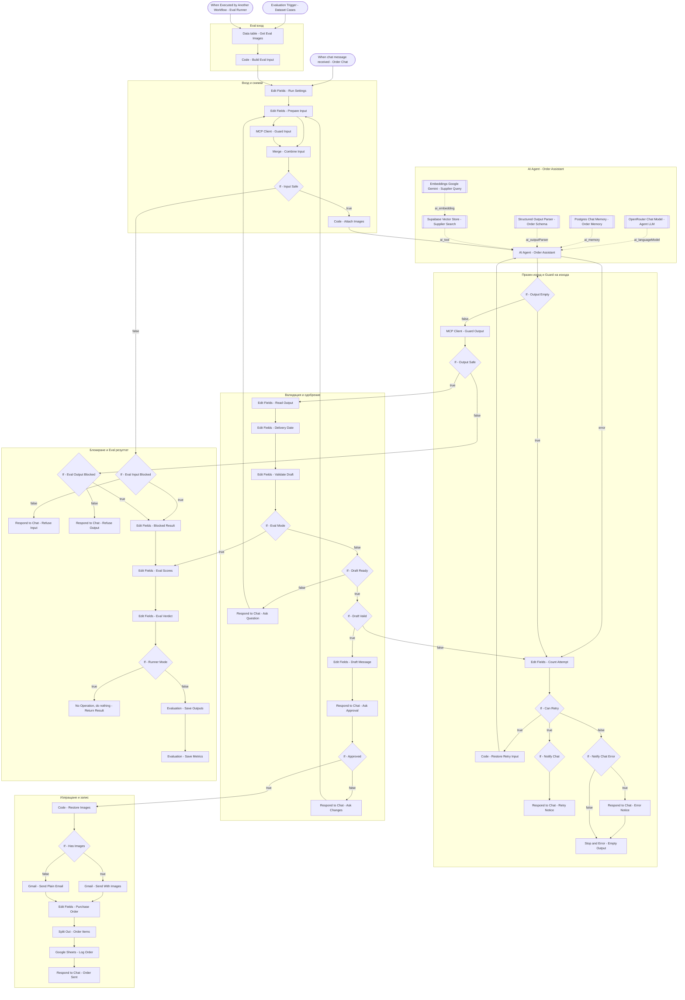

# 21-orders-processor - Решение

- Статус: `tested` (автоматични evaluations 16/16; пълен чат поток с одобрение - за ръчен ретест от Здравко)
- Версия: v3 (2026-11-01)
- Одобрен план: 2026-10-29 (persistent памет, MCP сървър за Guard, Code нод само за снимките, доставчици от Google Sheet)
- n8n папка: `Week 05 - HW 01 - Orders Processor`; таг `encorp-homework`
- Workflow-и:
  - `Encorp | Homework | Week 05 | HW 01 | Orders Processor` (основен, 67 нода) -> `n8n-workflows/21-orders-processor.json`
  - `... Orders Processor Guard MCP Server` -> `21-orders-processor-guard-mcp-server.json`
  - `... Orders Processor Guard Check` -> `21-orders-processor-guard-check.json`
  - `... Orders Processor Error Handler` -> `21-orders-processor-error-handler.json`
  - `... Orders Processor Suppliers Sync` -> `21-orders-processor-suppliers-sync.json`
  - `... Orders Processor Eval Runner` -> `21-orders-processor-eval-runner.json`

## Изисквания
R1-R16 в `assignment.md`.

## Идея
Един run на Chat Trigger (Response Mode = responseNodes) води целия разговор. Всяко съобщение към потребителя е Chat нод. Когато трябва отговор (липсваща информация, одобрение), run-ът чака на Chat нод "Send message and wait for response", а отговорът се връща в цикъла към `Edit Fields - Prepare Input`. Имейлът се праща само след бутона Потвърди.

Защитата от jailbreak е отделен workflow, изложен като MCP сървър (MCP Server Trigger -> Call n8n Workflow Tool `check_text` -> Guard Check с Guardrails, threshold 0.9). Основният поток го вика детерминирано с MCP Client нод на входа и на изхода на агента.

Агентът ползва Postgres Chat Memory (ключ `sessionId + executionId`), Supabase retrieve-as-tool за доставчиците (Gemini embeddings) и Structured Output Parser. Датата и денят от седмицата се смятат детерминирано (Luxon, Europe/Sofia) от `delivery_when`, не от модела. Снимките се прикачват към всяко извикване на агента.

Тестване: нативни n8n Evaluations (Evaluation Trigger - Dataset Cases върху Data Table `orders_eval_dataset`) и автоматичен Eval Runner, който пуска всички 16 случая и записва резултата в таб `eval_results`.

## Схема (основен workflow)

## Нодове (основен workflow)

| Група | Нодове | Защо | Покрива |
|-------|--------|------|---------|
| Вход | `When chat message received - Order Chat`, `Edit Fields - Run Settings`, `Edit Fields - Prepare Input`, `Merge - Combine Input`, `Code - Attach Images` | Публичен чат със снимки; настройки на едно място (тестов получател, опити, фирма, eval режим); единна форма на входа; снимките от първото съобщение се връщат към всяко извикване на агента (Code нод) | R1, R3, R15 |
| Guard | `MCP Client - Guard Input`, `If - Input Safe`, `MCP Client - Guard Output`, `If - Output Safe`, `Respond to Chat - Refuse Input/Output` | Детерминирана проверка през MCP; при засичане отказ | R13, R14 |
| Агент | `AI Agent - Order Assistant` + `OpenRouter Chat Model - Agent LLM` (openai/gpt-4.1-mini, temp 0), `Postgres Chat Memory - Order Memory`, `Structured Output Parser - Order Schema`, `Supabase Vector Store - Supplier Search` (topK 5), `Embeddings Google Gemini - Supplier Query` | Чернова, въпроси, няколко артикула, правила за доставчик (един / няколко / няма / грешка в името) | R2-R4, R7-R10 |
| Празен изход | `If - Output Empty`, `Edit Fields - Count Attempt`, `If - Can Retry`, `Code - Restore Retry Input`, `If - Notify Chat`, `Respond to Chat - Retry Notice`, `If - Notify Chat Error`, `Respond to Chat - Error Notice`, `Stop and Error - Empty Output` | До 2 повторни подавания в същия run; после съобщение и Stop and Error с контекст към Error Handler | R11, R12 |
| Валидация | `Edit Fields - Read Output`, `Edit Fields - Delivery Date`, `Edit Fields - Validate Draft`, `If - Draft Ready`, `If - Draft Valid` | Детерминирана дата и ден от седмицата (български), проверка на имейл и дата | R4, R6, R8-R10 |
| Одобрение | `Respond to Chat - Ask Question`, `Edit Fields - Draft Message`, `Respond to Chat - Ask Approval`, `If - Approved`, `Respond to Chat - Ask Changes` | Изпращане само след бутон Потвърди | R5, R6 |
| Изпращане и запис | `Code - Restore Images`, `If - Has Images`, `Gmail - Send With Images`, `Gmail - Send Plain Email`, `Edit Fields - Purchase Order`, `Split Out - Order Items`, `Google Sheets - Log Order`, `Respond to Chat - Order Sent` | Имейл с всички снимки; по един ред на артикул с общ номер на поръчка | R15, R16 |
| Evaluations | `Evaluation Trigger - Dataset Cases`, `When Executed by Another Workflow - Eval Runner`, `Data table - Get Eval Images`, `Code - Build Eval Input`, `If - Eval Mode`, `Edit Fields - Eval Scores`, `Edit Fields - Eval Verdict`, `If - Runner Mode`, `Evaluation - Save Outputs`, `Evaluation - Save Metrics`, `No Operation, do nothing - Return Result`, `Eval Input/Output Blocked?`, `Edit Fields - Blocked Result` | Входът идва от Data Table; Chat нодовете се прескачат в eval режим; оценка по статус, доставчик, артикули, количества, снимки, дата | тестване |

Другите workflow-и:
- **Guard MCP Server:** `MCP Server Trigger - Guard Server` -> Call n8n Workflow Tool `check_text` (-> Guard Check).
- **Guard Check:** Execute Workflow Trigger -> Guardrails (jailbreak, threshold 0.9, custom prompt за поръчки, OpenRouter gpt-4o-mini) -> при Fail Sheets append `jailbreak_log` -> Set `safe`, `reason`.
- **Error Handler:** `Error Trigger - Workflow Failure` -> `Edit Fields - Parse Context` (разбор на контекста) -> `Google Sheets - Log Error` (таб `error_log`) -> `Telegram - Send Alert`.
- **Suppliers Sync:** Schedule (на 5 минути) или Manual -> Sheets read `suppliers` -> Aggregate -> SHA-256 -> Postgres `supplier_sync_state` -> ако хешът е различен (или ръчно пускане): truncate `supplier_chunks`, Supabase insert (Gemini embeddings), запис на новия хеш.
- **Eval Runner:** Manual -> Data Table `orders_eval_dataset` -> Execute Workflow (всеки случай) -> Sheets append `eval_results` -> `Edit Fields - Pass Rate`.

## Допускания
Q4-Q16 в `assignment.md`. Допълнително:
- Q15 (променено): Google Sheets Trigger засича само нови редове, затова промените и изтриванията се засичат с хеш на целия таб на всеки 5 минути.
- Дати: моделът връща `delivery_when` (напр. "следващия понеделник"), а датата се смята от Luxon.
- Модел: gpt-4.1-mini вместо gpt-4o-mini заради по-добро следване на правилата за двусмислени доставчици и валиден изход по схемата (с gpt-4o-mini агентът често връща празен изход и фалшиво двусмислие).
- Supabase Vector Store - Supplier Search: topK 5 (при 2 търсенето по малко име пропуска втория доставчик със същото име).
- Правило 2 в промпта: един запис е един доставчик; двама са само при различна фирма и различно лице, и двамата със същото име; пример за малко име.

## Credentials
OpenRouter, Google Gemini(PaLM), Supabase, Postgres, Gmail, Google Sheets, Telegram (имената са санитизирани в JSON).

## Google Sheet
Документ `Encorp HW W05-01 Orders Processor - Logs`: табове `purchase_orders`, `jailbreak_log`, `error_log`, `suppliers`, `eval_results`.

## Data Tables
`orders_eval_dataset` (16 случая E01-E10e), `orders_eval_images` (тестови снимки в base64).

## Покритие
R1 -> When chat message received - Order Chat; R2 -> AI Agent - Order Assistant, Edit Fields - Draft Message; R3 -> When chat message received - Order Chat, Code - Attach Images; R4 -> AI Agent - Order Assistant, Respond to Chat - Ask Question; R5 -> Respond to Chat - Ask Approval, If - Approved; R6 -> Edit Fields - Draft Message; R7 -> Supabase Vector Store - Supplier Search, Suppliers Sync; R8, R9 -> AI Agent - Order Assistant; R10 -> Edit Fields - Validate Draft; R11 -> Stop and Error - Empty Output + Error Handler; R12 -> блок Празен изход; R13 -> MCP Client - Guard Input/Output + Guard workflow-и; R14 -> Guard Check; R15 -> Send Email; R16 -> Google Sheets - Log Order.

## Режим на доставка
Директно в n8n през MCP. Към 2026-11-02 всичките 6 workflow-а са непубликувани (unpublish по искане на Здравко); за работа на Chat Trigger и Guard през MCP основният workflow, Guard Check и Guard MCP Server трябва да се публикуват отново. JSON копия в `n8n-workflows/` след санитизиране.

## Error handling и идемпотентност (v5)
Одобрение -> Crypto - Order Key -> Edit Fields - Order Identity -> Data table - Find Order -> Switch - Order State:
- new: Data table - Claim Order (status claimed), после изпращане;
- claimed: Gmail - Check Sent; ако има писмо, само запис в Sheets, иначе изпращане;
- sent: само запис в Sheets;
- logged: Respond to Chat - Already Sent.
След Gmail: Data table - Mark Sent; след Sheets (upsert по po_number + line_no): Data table - Mark Logged. При грешка в Gmail: Respond to Chat - Send Failed и Stop and Error - Send Failed.

## Сетъп на нова инстанция
CSV шаблоните, SQL за Supabase и списъкът с ръчните стъпки са в `setup/` (виж `setup/README.md`) и в Sticky Note "Prerequisites" в основния workflow. Стратегията за грешки е в Sticky Note "Стратегия за обработка на грешки".
